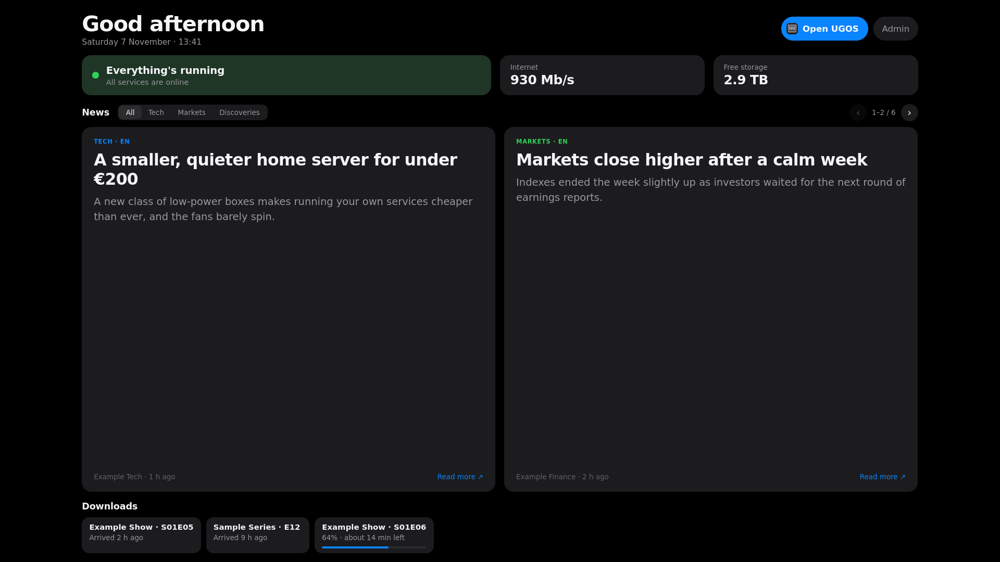
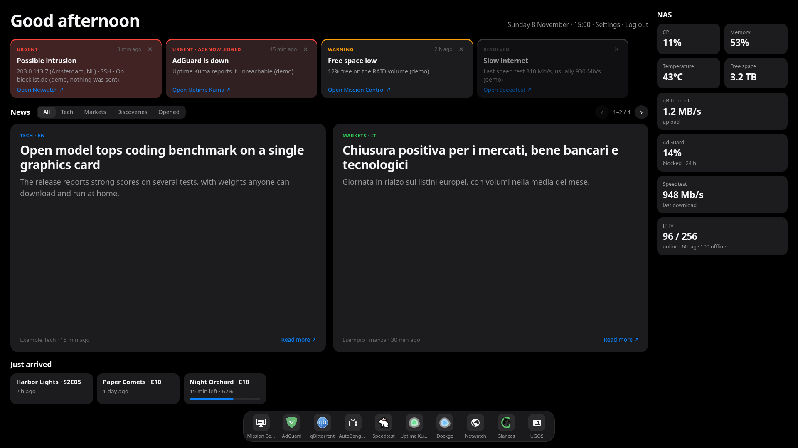
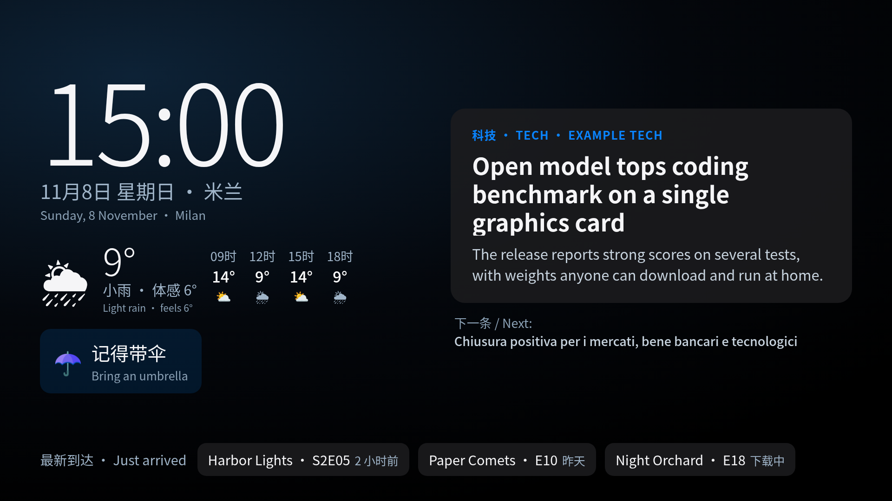
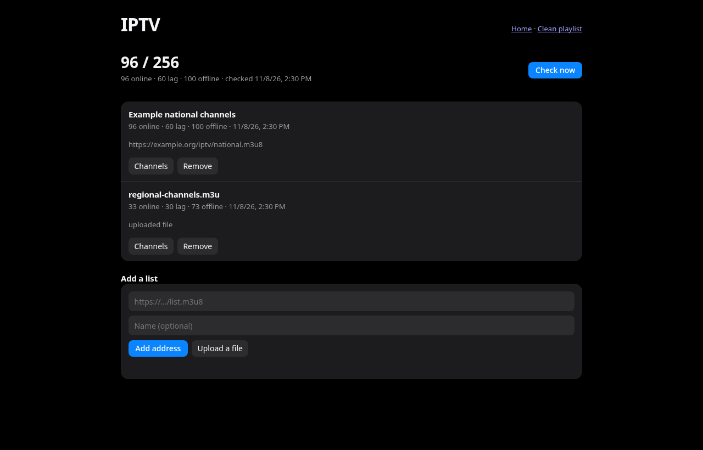
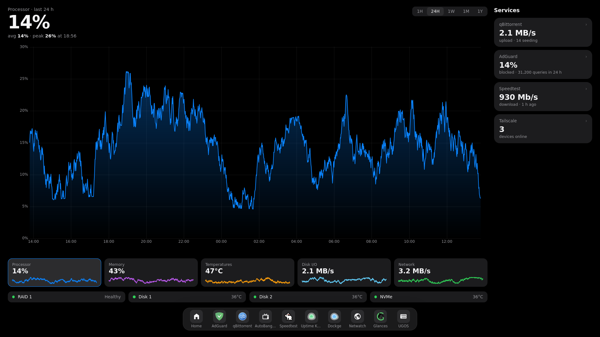
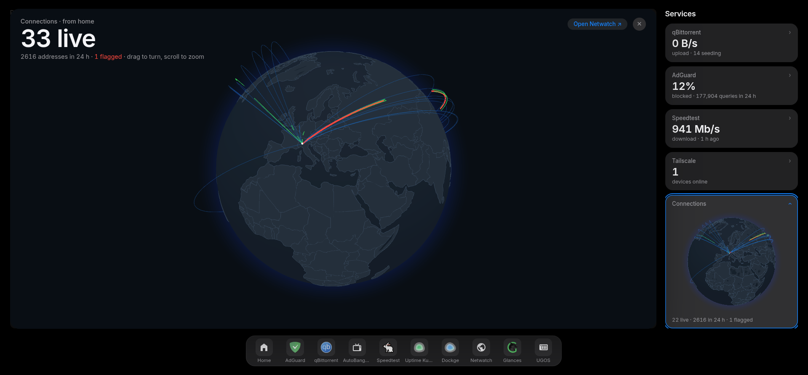
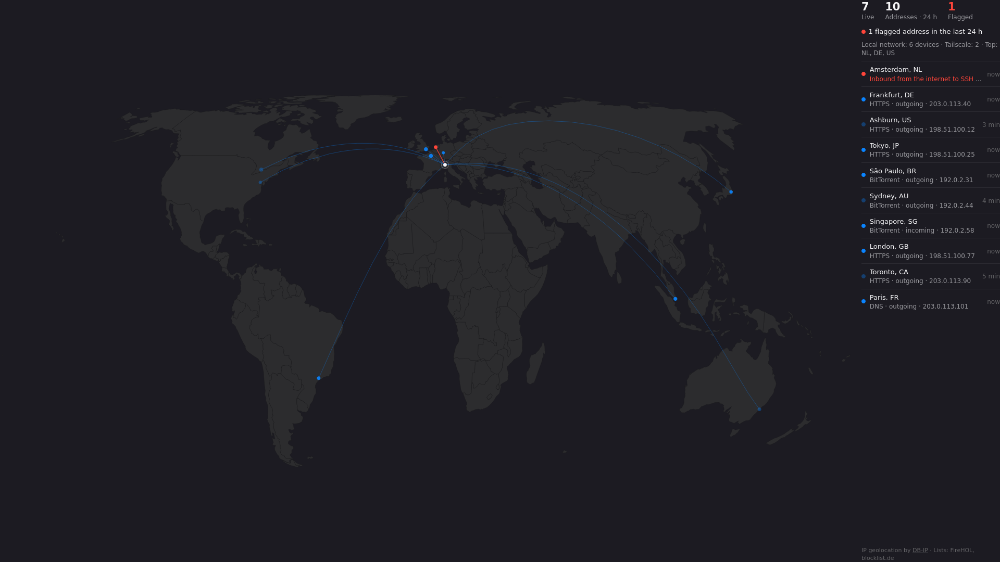
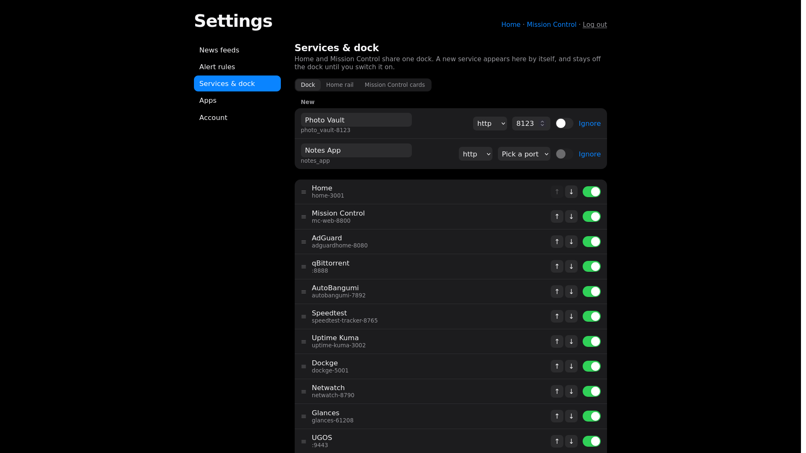
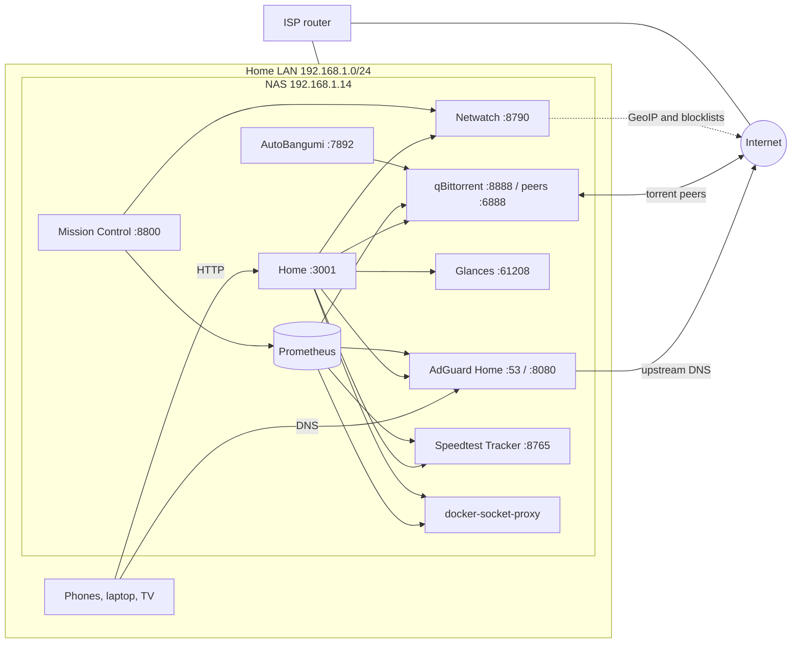

# NAS homelab

Technical documentation and configuration for the home NAS (UGREEN DXP4800, UGOS Pro).
Every Docker stack running on the NAS is mirrored here, with secrets removed, so changes can be reviewed, versioned and rolled back.

- **Home** (guest summary): http://192.168.1.14:3001 — the owner's page is at `/admin/`, behind the admin login
- **Mission Control** (performance history): http://192.168.1.14:8800 — needs the admin login
- **Last full review:** 2026-11-06

---

## Screenshots

Made-up data unless noted, because this repo is public. All of them, with descriptions, are in [`docs/screenshots`](docs/screenshots/README.md).

**Guest page:** what family and guests see at `:3001`.



**Owner's page:** alerts in priority order, news, arrivals and the dock, behind the admin login.



**TV idle page:** what the Fire TV shows when nobody is using it, at `/tv`.



**IPTV lists:** channel status per playlist, with lists added by address or file.



**Mission Control:** performance history, disks and services.



**Connections globe:** live connections from home, expanded from Mission Control's rail. This one is the real page, with no addresses or names showing.



**Netwatch:** where the NAS's connections go, with flagged addresses in red.



**Settings:** feeds, alert rules, dock order and account, with new containers appearing by themselves.



---

## Contents

1. [Hardware and OS](#1-hardware-and-os)
2. [Network](#2-network)
3. [Services](#3-services)
4. [Storage layout](#4-storage-layout)
5. [Home (landing page)](#5-home-landing-page)
6. [Netwatch (connection map)](#6-netwatch-connection-map)
7. [Mission Control (performance history)](#7-mission-control-performance-history)
8. [Media pipeline](#8-media-pipeline)
9. [Operations](#9-operations)
10. [Security](#10-security)
11. [Known issues and next steps](#11-known-issues-and-next-steps)
12. [Changelog](#12-changelog)

---

## 1. Hardware and OS

| Item | Value |
|---|---|
| Model | UGREEN DXP4800 |
| CPU / RAM | Intel N100 (4 cores) / 8 GB |
| Data disks | 2 × 4 TB Seagate IronWolf, **RAID 1** |
| Cache | 500 GB Crucial NVMe as an LVM cache in **writethrough** mode (no data loss if it fails) |
| Filesystem | btrfs on `/volume1` (~3.6 TB usable) |
| OS | UGOS Pro (Debian 12 based), kernel 6.18 |
| Docker | Engine 29.6, Compose v5.1 |

Harmless kernel message: `btrfs usrquota disabled (failed to load tree)`.

## 2. Network

| Item | Value |
|---|---|
| Router | ISP router (Wi-Fi 6), `192.168.1.1` |
| NAS address | `192.168.1.14`, reserved by DHCP (eth0) |
| LAN DNS | AdGuard Home on the NAS. The router hands out `192.168.1.14` as DNS to every device (*Configura il DNS per tutti i dispositivi*). |
| IPv6 DNS | AdGuard public DNS `2a10:50c0::ad1:ff`. The LAN has no global IPv6, so this field only satisfies the router form. |
| Port forwarding | None automatic: the router does not answer UPnP requests (checked with `scripts/upnp_list.py`). |
| Remote access | **Tailscale** (stack `tailscale`). The NAS is node `nas` on the tailnet and advertises the subnet route `192.168.1.0/24`, so the `192.168.1.x` addresses work from outside home. The route must be approved once in the Tailscale admin console. |



## 3. Services

All stacks live in `/volume1/docker/<stack>/` on the NAS and in [`stacks/`](stacks/) here, except the two UGREEN app-store apps.

| Service | URL | Stack folder | Purpose |
|---|---|---|---|
| AdGuard Home | http://192.168.1.14:8080 | `adguard` | Network-wide ad and tracker blocking (DNS) |
| Home | http://192.168.1.14:3001 | `home` | Public summary for family and guests, the TV idle page at `/tv` and the clean IPTV playlist at `/iptv.m3u`; the owner's page at `/admin/` (attention with urgent takeover + push, news, arrivals, IPTV lists, dock) needs the admin login (own code) |
| Homepage (retired) | — | `homepage` | Old gethomepage dashboard; only its docker proxy (`dockerproxy-2375`) still runs |
| qBittorrent | http://192.168.1.14:8888 | UGREEN app (`@appstore`) | Downloads and seeding |
| AutoBangumi | http://192.168.1.14:7892 | `autobangumi` | Anime RSS (Mikan) → qBittorrent, renames for the Theater |
| Speedtest Tracker | http://192.168.1.14:8765 | `speedtest-tracker` | Internet speed test every 6 h, 1 year of history |
| Uptime Kuma | http://192.168.1.14:3002 | `uptime-kuma` | Uptime monitors and phone alerts (ntfy) |
| Dockge | http://192.168.1.14:5001 | `dockge` | Web UI for compose stacks in `/volume1/docker` |
| Glances | http://192.168.1.14:61208 | `glances` | System metrics, behind its own password (user `glances`) |
| Netwatch | http://192.168.1.14:8790 | `netwatch` | Connection map and attacker flags (own code) |
| Mission Control | http://192.168.1.14:8800 | `mission-control` | Performance history (1 year) + service stats, one screen, needs the admin login (own code + Prometheus) |
| Minecraft | `192.168.1.14:25565` | `minecraft_server` | Fabric server, whitelisted; **normally stopped** |
| Tailscale | — | `tailscale` | Remote access: node `nas` plus a subnet route for the home LAN |
| Firefox | http://192.168.1.14:5888 | UGREEN app (`@appstore`) | Browser on the NAS; also used for headless screenshots |
| UGOS / Theater | https://192.168.1.14:9443 | built in | NAS admin, 影视中心 (media library) |

Containers are named `name-port` (`autobangumi-7892`), except `tailscale` (no port) and the UGOS-managed apps.

Notes per service:

- **AdGuard Home**
  - Port 53 is bound to `192.168.1.14` only. Binding `0.0.0.0:53` clashes with the dnsmasq that UGOS runs for its VMs.
  - `network_mode: bridge` is set explicitly, because the UGOS project UI created the container without a network.
  - Its own config (`conf/AdGuardHome.yaml`) holds a password hash, so it is **not** in this repo.
  - Filter lists: AdGuard DNS filter, HaGeZi Pro, HaGeZi Threat Intelligence Feeds (malware/phishing, ~1.4 M rules) and CHN: anti-AD (Chinese ad networks). With all four, AdGuard uses ~600 MB RAM. Custom rule: `||imasdk.googleapis.com^` (Google's video pre-roll SDK; olevod still plays with it blocked).
  - DNS can't remove first-party banners (e.g. olevod serves ads from the same API as its content); use Brave Shields → Aggressive / *Block element* for those.
- **qBittorrent (UGREEN app)**
  - Compose file is in `/volume1/@appstore/com.ugreen.docker.qbittorrent/` and owned by root.
  - I added the mount `/volume1/电影-电视剧-番剧:/media` by hand. A UGREEN app update may revert it.
  - Recreate it with `sudo docker compose -p qbittorrent up -d` from that folder.
  - All ratio, seeding-time and inactive-seeding limits are off, so torrents seed indefinitely.
  - It locks an IP out after 5 failed Web UI logins; restarting the app clears the ban.
- **AutoBangumi**
  - Downloader is `192.168.1.14:8888`.
  - Save path is `/media/番剧`, as seen from inside the qBittorrent container.
  - Rename method `pn`. Renaming happens through qBittorrent, so seeding continues after renames.
  - Its `config/config.json` contains the qBittorrent password, so it is **not** in this repo.
- **Speedtest Tracker**
  - `APP_KEY` is in its `.env`.
  - Homepage reads results with a token that has the `results:read` ability, stored as `HOMEPAGE_VAR_SPEEDTEST_KEY`.
  - A token stops working when the user who owns it is deleted. If the dashboard card shows *API Error*, recreate the token (see [§8](#8-operations)).
- **Uptime Kuma**
  - Runs v2 (`louislam/uptime-kuma:2`). The pre-upgrade 1.23.17 data is kept in `data.bak-1.23.17`.
  - The Theater monitor needs **Ignore TLS errors**, because `:9999` redirects to `https://…:9443`, which uses a self-signed certificate.
  - Phone alerts go to a private ntfy.sh topic (the same one Netwatch and Home use, `NTFY_URL` in their `.env`).
- **Tailscale**
  - Official `tailscale/tailscale` image, host network, kernel mode (`/dev/net/tun`, `NET_ADMIN`). Node `nas`, with a 100.x Tailscale address and a MagicDNS name `nas.<tailnet>.ts.net`.
  - The entrypoint runs `tailscaled` directly. The image's own start-up script (containerboot) gives up on an interactive login after 60 s and restarts in a loop, so it is bypassed.
  - Settings come from a one-time `tailscale up --hostname=nas --advertise-routes=192.168.1.0/24 --accept-dns=false` and are stored in `state/` with the node identity. Restarts reconnect on their own (tested). If `state/` is lost, run that command again with `docker exec`.
  - Key expiry is disabled and the subnet route is approved in the admin console.
  - IP forwarding is already on, because Docker enables it.
  - The old Homepage also accepted its Tailscale address and MagicDNS name (`HOMEPAGE_ALLOWED_HOSTS`, in its `.env`).
- **Dockge**
  - Mounts the Docker socket, which is root-equivalent, so its login must stay strong.
  - It does not manage the `@appstore` stacks.

## 4. Storage layout

```
/volume1/
├── docker/                    # all self-managed stacks (one folder each)
├── Torrent-files/             # qBittorrent default download folder (/downloads)
└── 电影-电视剧-番剧/            # organised media (qBittorrent /media)
    ├── 电影/                   # movies   ┐
    ├── 电视剧/                  # TV       ├─ UGOS Theater libraries (share root is NOT scanned)
    ├── 番剧/                   # anime    ┘   AutoBangumi saves here
    └── _Extras/               # BD menus, PVs, SPs, 特典 moved out of the libraries
        ├── moves.log          # tab-separated "original → new" paths (undo log)
        └── _broken_empty_files/
```

Theater conventions:

- **Rescanning:** the Theater rescans live when files move.
- **Pinning a show:** for a title it keeps mismatching, put a `tvshow.nfo` with the TMDB id in the show folder:
  ```xml
  <?xml version="1.0" encoding="UTF-8" standalone="yes"?>
  <tvshow><title>…</title><uniqueid type="tmdb" default="true">ID</uniqueid><tmdbid>ID</tmdbid></tvshow>
  ```
  Already done for three shows that kept mismatching. Look the id up on TMDB; never guess it.
- **File names matter more than the nfo:** the Theater takes the show title from the episode file names. All-bracket names like `[GROUP][SHOW][111].rmvb` get parsed as "Group Show" and split into several unmatched shows, even with a `tvshow.nfo`.
  - Fix: rename to `Season NN/<Show> SNNEMM.ext`, mapping absolute numbers to the TMDB seasons, **through qBittorrent** (`torrents/renameFile`), so seeding continues.
  - A long series was fixed this way (300+ files → 7 seasons), with an undo map saved in `_Extras/`.
  - Renaming orphans the Theater's hidden `.fg.op/.fg.ed` intro-skip markers. Park them in `_Extras`; the Theater regenerates them.
- **Moving finished torrents:** use qBittorrent's *Set location* to `/media/...`, not the File Manager, so seeding continues.
- **Inspecting the index:** the Theater's search index is readable with sqlite: `@appstore/com.ugreen.videomgr/@search/app_idx_data/{video_info,file_info}/content.db`.

## 5. Home (landing page)

The page on **:3001** (own code, stack [`stacks/home`](stacks/home/)). It replaced the gethomepage dashboard on 2026-11-07. Design: [`docs/superpowers/specs/2026-11-07-home-info-flow-design.md`](docs/superpowers/specs/2026-11-07-home-info-flow-design.md).

**Who sees what.** Design: [`docs/superpowers/specs/2026-11-07-public-summary-design.md`](docs/superpowers/specs/2026-11-07-public-summary-design.md).

- **Guests at `/`:** plain-language status (only "Everything's running" when every source could be read), internet speed, free storage, news without the *Opened* tab, downloads, **Open UGOS** (each person logs in with their own UGOS account) and **Admin**. Recognised episodes appear by name; everything else is only counted ("1 other download"). Intrusion alerts never reach this page. All of it comes from `/api/public/summary` and `/api/news`.
- **IPTV check:** every 6 h the NAS downloads a real video segment from each channel of the managed playlists. The rail card shows how many are online, lagging (segment under 1.5× real time) or offline and opens `/admin/iptv.html`, where lists are added by address or file, removed and checked on demand. `/iptv.m3u` serves only the fast channels. If fewer than 20 pass, the previous playlist is kept. `IPTV_LISTS` in `.env` only fills the first lists; the checker refuses private addresses, so a list can't reach the NAS's own services.
- **TV at `/tv`:** the TV idle screen, public and without buttons. Clock, Milan weather from Open-Meteo (the NAS fetches it every 30 min; hidden after 3 h without data), one what-to-bring tip, rotating news in its original language and recognised episodes. Labels are Simplified Chinese with a small English line. The status line appears only when something is wrong. Data from `/api/public/tv` and `/api/news`. Design: [`docs/superpowers/specs/2026-11-08-tv-idle-screen-design.md`](docs/superpowers/specs/2026-11-08-tv-idle-screen-design.md).
- **Owner at `/admin/`:** everything described below, behind the admin login.

**Admin login.** One password for Home, Mission Control and Netwatch, shared through a signed cookie (`stacks/home/auth.py`, copied into the other two stacks).

- **Where it lives:** `/volume1/docker/admin-auth/auth.json` (mode 600, not in git). Home mounts the folder read-write; Mission Control and Netwatch read-only. The services notice a change straight away, with no restart.
- **Changing it:** Settings → Account. If the password is forgotten: `python3 scripts/set-admin-password.py | ssh <user>@192.168.1.14 'cat > /volume1/docker/admin-auth/auth.json; chmod 600 /volume1/docker/admin-auth/auth.json'`. That logs every device out.
- **Sessions:** 30 days with "remember", otherwise 12 hours or until the browser closes. Cookies are per hostname, so the LAN address and the Tailscale name each need their own login.
- **Wrong passwords:** after 5 failures from one address, wait 30 s, doubling up to 15 min.
- **If the file is missing or invalid:** every login is refused, locked routes stay locked, and each service logs why at start-up.

**Owner's page layout.** Desktop fits one screen; phones stack and scroll.

- **Header:** greeting by time of day, plus date and time, and **Log out**.
- **Needs attention:** one card per alert in a row at the top, in priority order: urgent, urgent but acknowledged (kept as a red banner card while the problem lasts), warning, resolved. With nothing to report it reads *All quiet on the NAS*.
  - Each card has ✕ to dismiss and a link to the right app.
  - Dismissals are stored on the NAS, so they sync across devices.
- **News:** a two-card flashcard carousel (one card on phones).
  - ← → buttons, the plain keyboard arrows or a swipe move **one card per step**. Alt/Ctrl/Shift+arrows are left to the browser.
  - Filter: All / Tech / Markets / Discoveries / **Opened** (stories whose link you opened, last 30 days).
  - Each card shows the feed's own summary and a *Read more ↗* link.
- **Just arrived:** episodes finished in the last 48 h, plus anything downloading (progress, time left, *stalled*), read from qBittorrent.
- **Right rail:** CPU, memory, temperature, free space, qBittorrent, AdGuard and Speedtest. Each one opens Mission Control at the matching chart or card; Mission Control itself is reached from the dock (no duplicate link).
- **Dock:** the same apps as Mission Control's dock, plus Mission Control itself.

**Settings** (`/admin/settings`, behind the admin login). Design: [`docs/superpowers/specs/2026-11-07-admin-settings-design.md`](docs/superpowers/specs/2026-11-07-admin-settings-design.md). Every change saves at once.

- **News feeds:** switch on or off, add by address + topic + language (the NAS test-fetches it first), or remove.
- **Alert rules:** the numbers in the table below, and phone notifications on or off. The switch covers Home and Netwatch; Uptime Kuma has its own notification settings.
- **Services & dock:** what appears, and in what order, in the dock (shared with Mission Control), the Home rail and the Mission Control cards. A new container appears under "New", switched off: name and port are filled in where Docker makes them clear, otherwise the row asks.
- **Apps:** links into each app's own settings and UGOS.
- **Account:** change the password (other devices are logged out), or log out everywhere.
- **Where it's stored:** `home/data/settings.json`, not in git. [`feeds.json`](stacks/home/feeds.json) is only the first-run list. A file that can't be read is renamed `settings.json.bad-<time>`, Home runs on the defaults, and the page says so.
- **Mission Control and Netwatch** read the dock, cards and phone switch from Home's `/api/internal/layout`, which only answers this machine. If Home is down, they use their built-in defaults, and Netwatch keeps alerting.

**Attention rules.** The numbers below are the defaults; they can be changed in Settings.

| Level | When |
|---|---|
| **Urgent** (full-screen takeover + ntfy push "URGENT: …") | an inbound attack lasting ≥ 3 min (Netwatch); a service down > 2 min (Uptime Kuma); RAID degraded; a drive failing SMART; a container restarting ≥ 3 times in 10 min |
| Normal (pinned) | a service down for less than 2 min; an outgoing connection to a flagged address; free space < 15 %; the last speed test < 50 % of the 30-day median; a drive above 50 °C |

- Incidents clear themselves and stay listed as *resolved* for 24 h. If the same problem comes back, it alerts again.
- **Acknowledge** closes the takeover on every device; the item stays pinned while the problem lasts. One push is sent per incident.
- Uptime Kuma and Netwatch keep sending their own alerts.

**News feeds:** managed in Settings. The first-run list, [`feeds.json`](stacks/home/feeds.json), holds 11 English and Italian sources: The Verge, TechCrunch, Ars Technica, MIT Technology Review, Wired Italia, DDay.it, Il Sole 24 Ore (Tecnologia and Finanza), CNBC (Markets and Technology) and ScienceDaily.

- Feeds are fetched every 15 min and kept for 3 days.
- Near-duplicate stories are merged, and each source is limited to 8 stories so busy feeds can't take over.
- Summary text is reduced to plain text on the server.
- **Archive** (`data/news.db`, SQLite): every story shown is kept for 30 days; stories whose *Read more* link you clicked are kept for 90 days from the last click, with an open count. Pruned on every feed refresh.

**How it works.** One Python process (stdlib only, ~20 MB RAM), `server.py`, with pure modules `feeds.py`, `attention.py`, `arrivals.py`, `weather.py` and `iptv.py`.

- **Workers:** feeds every 15 min, attention every 30 s, arrivals every 60 s, weather every 30 min, IPTV check every 6 h.
- **State:** `data/state.json` (incidents, dismissals, acknowledgements).
- **API:**
  - `GET /api/attention`, `/api/news?topic=`, `/api/arrivals`, and `/api/prom/query` (read-only, instant queries only).
  - `POST /api/attention/<id>/dismiss|ack` (change only the state file) and `POST /api/news/<id>/open` (records a click in the archive).
- **Inputs:** Prometheus, Netwatch, the docker proxy (`RestartCount`), qBittorrent and Uptime Kuma `/metrics`. Kuma needs `KUMA_API_KEY` in `home/.env`; without it, those rules are skipped and the API lists `kuma` in `sources_down`.
- **Previews:** `?demo=urgent` shows the takeover and `?demo=many` shows four sample alert cards, without storing or pushing anything. Headless screenshots also need `?static`.
- **Push limits:** one push per incident, the same problem at most once an hour, at most 10 urgent pushes an hour. An attack must still be live on polls ≥ 3 min apart to escalate (a single sighting never takes over).
- **Tests:** `python3 -m unittest discover -s tests` in `stacks/home`, and `node --test lib.test.mjs` in `static/`.

**Old Homepage.** Its config stays in [`stacks/homepage`](stacks/homepage/). The service is behind the compose profile `old`, so `docker compose up -d` in that folder starts only the `dockerproxy` that Home and Mission Control use. To bring it back: `docker stop home && docker compose --profile old up -d homepage`.

## 6. Netwatch (connection map)

Own code in [`stacks/netwatch`](stacks/netwatch/): Python 3.12 using only the standard library plus `maxminddb`. It runs with host networking.

- **Data source:** every 5 s it reads the host's TCP table (`/proc/net/tcp`, `/proc/net/tcp6`) and keeps ESTABLISHED connections. It classifies each remote address as *internet*, *LAN* or *Tailscale* (`100.64.0.0/10`). Loopback and Docker bridge traffic are ignored.
- **Direction:**
  - *Incoming* means the local port is a listening port; the service is named from the local port.
  - *Outgoing* is named from the remote port: HTTPS, DNS, … and "Torrent peer" for high ports.
- **Geolocation:** DB-IP City Lite (CC BY 4.0, attribution shown in the UI).
  - Downloaded monthly to `data/`, falling back to the previous month.
  - Offline: no address is ever sent to a third party.
- **Red flags:** an address is red if it is either:
  1. on **FireHOL level 1** or **blocklist.de/all**, refreshed every 12 h. Private and bogon ranges in FireHOL are ignored; or
  2. connecting **in** from the internet to anything other than the torrent port (`TORRENT_PORT`, 6888).
- **History:** 24 h, saved to `data/history.json` every minute.
- **Phone alert:** a newly flagged address triggers an ntfy notification (`NTFY_URL`, same topic as Uptime Kuma).
  - One alert per address per 24 h.
  - Flags found in the same poll are grouped into one message.
  - At most 10 alerts per hour.
- **API:** `GET /api/state` returns a summary and up to 400 items, with flagged items first.
- **UI:** `static/index.html`, a d3 Equal Earth map with lines from home (Milan, `HOME_LAT/LON`) plus a side panel. `static/` is mounted read-only, so page edits need no rebuild. `app.py` changes need `docker compose up -d --build`.
- **Limits:**
  - TCP only: uTP/UDP torrent peers and DNS queries are invisible.
  - Only the NAS's own connections.
  - City accuracy is approximate; anycast CDNs appear at their registration city.

Verified:

- An IP taken from blocklist.de and an address inside a FireHOL CIDR are both flagged.
- `1.1.1.1` and `8.8.8.8` are not.

## 7. Mission Control (performance history)

A one-screen page for "what happened?": every chart opens on the last 24 h and goes back up to a year. Design: [`docs/superpowers/specs/2026-11-06-mission-control-design.md`](docs/superpowers/specs/2026-11-06-mission-control-design.md). Stack: [`stacks/mission-control`](stacks/mission-control/).

**Layout** (desktop never scrolls; phones stack and scroll):

- **Main flow (left):** the selected metric large (value, "avg · peak at HH:MM", 1H/24H/1W/1M/1Y), a big chart (hover reads any moment in the header line, no floating tooltip), five metric tiles (Processor, Memory, Temperatures, Disk I/O, Network: click one to chart it) and a one-line disks strip (RAID 1, Disk 1, Disk 2, NVMe: health dot + temperature, details on hover/click).
- **Rail (right):** qBittorrent, AdGuard, Speedtest, Tailscale and Connections cards, one key number each. **Every card expands** over the main flow (grows out of the card; ✕, Esc or clicking the card again closes it; another card swaps in place). Connections expands into a draggable 3D globe of Netwatch's connections (red = flagged).
- **Dock (bottom):** the same apps as Homepage's dock plus Homepage itself; icons are stored in `web/static/icons/` (no CDN). Links use the address the page was opened with, so they also work over Tailscale.
- Each expanded card has an **Open … ↗** button to the service's own web UI (Tailscale opens its admin console, Connections opens Netwatch).
- The globe merges connections to the same place (0.5° grid) into one arc, draws past connections as plain lines and only live/flagged ones as tubes, and pauses the rail preview while the big globe is open, to keep zooming smooth.
- The view lives in the URL (`#temps/1W`, `#card=adguard/24H`), so a reload or a bookmark keeps it.

**Architecture** (all host networking; everything listens on `127.0.0.1` except the page):

| Container | Role | Port |
|---|---|---|
| `mc-prometheus-9090` | Time-series database, scrape every 15 s, retention 365 days, data in `data/prometheus` | 127.0.0.1:9090 |
| `mc-node-exporter-9100` | CPU, memory, load, temperatures (hwmon), disk I/O, network, md RAID | 127.0.0.1:9100 |
| `mc-smartctl-exporter-9633` | SMART for `sda`, `sdb`, `nvme0` (see Security) | 127.0.0.1:9633 |
| `mc-collector-9101` | Own Python (stdlib only): per-container CPU/RAM via the read-only docker proxy, qBittorrent, AdGuard, Speedtest Tracker, Tailscale (local API socket). A failing source only sets `mc_up{source=…} 0` | 127.0.0.1:9101 |
| `mc-web-8800` | Own Python: serves the page and vendored JS (uPlot, globe.gl, topojson), proxies only Prometheus `query`/`query_range` and Netwatch `/api/state` | **0.0.0.0:8800** |

- Collector logins are in `mission-control/.env` (keys in `.env.example`).
- Tailscale's socket is shared through `tailscale/run/` (mounted at `/var/run/tailscale`).
- The docker proxy (homepage stack) is also published on `127.0.0.1:2375` for the collector.
- Page files (`web/static/`) are mounted read-only: edits need no rebuild. Python changes need `docker compose up -d --build <service>`.
- Tests: `python3 -m unittest discover -s tests` in `collector/` and `web/`; `node --test lib.test.mjs geo.test.mjs` in `web/static/`.
- Cost: ~120 MB RAM for all five containers at start; Prometheus disk grows to a few GB per year.

**Adding a card:** add an entry to `CARDS` in `web/static/metrics.js` (key number, chart series, tiles as PromQL). If the data isn't in Prometheus yet, add a parse function in `collector/sources.py` (with a fixture test) and a fetcher in `collector.py`.

## 8. Media pipeline

```
Mikan RSS ──► AutoBangumi ──► qBittorrent ──► /media/番剧/<Show>/Season N/  ──► UGOS Theater
                              (rename "pn")      (seeds forever)
```

- **RSS feeds:** per-show RSS links with a fixed release group, preferring 1080p with switchable simplified/traditional Chinese subtitles.
- **Episode numbering:** some groups number episodes across seasons (e.g. "29" for S2E4), so use AutoBangumi's episode offset for those.
- **Manual downloads:** they land in `/volume1/Torrent-files`. Move them into the library with qBittorrent *Set location*.

## 9. Operations

Access: `ssh <user>@192.168.1.14`, key login. The user is in the `docker` group, and sudo needs the password.
UGOS sometimes switches SSH off by itself; turn it back on in *Control Panel → Terminal*.

Common tasks:

| Task | Command (on the NAS, in the stack folder) |
|---|---|
| Apply compose changes | `docker compose up -d` |
| Reload `.env` | `docker compose up -d --force-recreate` |
| Update an image | `docker compose pull && docker compose up -d` |
| Rebuild Netwatch / Mission Control code | `docker compose up -d --build [service]` |
| Logs | `docker logs --tail 50 <container>` |

Copying files to the NAS:

- `scp`/`sftp` cannot write under `/volume1`. Use `ssh <user>@192.168.1.14 'cat > /path/file' < localfile`, or for folders `tar -C dir -cf - . | ssh … 'tar -C /dest -xf -'`.
- [`scripts/sync-from-nas.sh`](scripts/sync-from-nas.sh) pulls the current configs back into this repo. Run it before committing.

Recreate the Speedtest token (read by Mission Control's collector):

1. On the NAS, run a short PHP script inside the container that boots Laravel and calls `User::first()->createToken('homepage', ['results:read'])`. The container has no `artisan tinker`.
2. Write the token to `SPEEDTEST_KEY` in `mission-control/.env`.
3. Recreate the collector: `docker compose up -d --force-recreate collector`.

Screenshots for design checks (headless Firefox inside the UGREEN Firefox app container):

- `scripts/shoot.sh` (run on the NAS) serves `shotserver.py`, a page that iframes the dashboard and delays the `load` event by 9 s, so the data has time to arrive.
- It captures `monitor` 1920×1080, `laptop` 1800×1125 and `phone` 400×860 into `~/shot/`. Other pages and sizes: `sh shoot.sh <URL> name:W,H …`. Captures use dark mode.
- CDN logos don't render in headless captures; real browsers show them.
- Headless Firefox never advances animations and has no WebGL: capture Mission Control with `?static` (no animations); the globe can only be checked in a real browser.

Root-only tasks:

- Running root commands through a privileged container is deliberately not done.
- Root steps, such as editing `@appstore` compose files, are run by hand with `sudo`.

## 10. Security

| Area | State |
|---|---|
| Exposure | No automatic port forwards (UPnP silent). Remote access only through Tailscale, which needs your account; nothing is opened on the router. |
| Logins | AdGuard, qBittorrent, Uptime Kuma, Dockge, AutoBangumi and Speedtest Tracker each have their own admin account. Defaults (AutoBangumi `admin/adminadmin`, Speedtest `admin@example.com/password`) must be changed. |
| Docker socket | Dockge has full access (root-equivalent). Home and Mission Control only get the read-only proxy (also on `127.0.0.1:2375`, NAS-local). |
| Home | The only writes are `POST /api/attention/<id>/dismiss|ack`, which change Home's own `data/state.json`. Feed text is reduced to plain text and escaped before display. No login (LAN + tailnet only). |
| Raw disk access | `mc-smartctl-exporter-9633` gets exactly `/dev/sda`, `/dev/sdb`, `/dev/nvme0` with `SYS_RAWIO`/`SYS_ADMIN` to read SMART (approved 2026-11-06). Not privileged. |
| Mission Control | Prometheus, exporters and collector listen on `127.0.0.1` only; the page (:8800) exposes read-only queries, never Prometheus' admin API. Every path needs the admin login. |
| Admin login | Home's `/admin/` and APIs, Mission Control and Netwatch refuse without the session cookie (HttpOnly, SameSite=Strict). Netwatch skips the check for requests from `127.0.0.1`, because Home and Mission Control read it over loopback. Over plain HTTP until HTTPS arrives (#6), the password and cookie travel unencrypted on the home network (Tailscale encrypts its own traffic), and other apps on the same address also receive the cookie. |
| Glances | Its own password (`glances/data/glances.pwd`, a hash, not in git). `/api/4/status` (version only), `/docs` and `/openapi.json` (generic API description) stay open; they hold no system data, and everything else answers 401. |
| Secrets | `.env` files and app data are never committed. See `.gitignore` and the `.env.example` files. |
| Runs as root | The UGREEN qBittorrent app uses `PUID=0`/`PGID=0`. |
| Monitoring | Uptime Kuma (service up/down → ntfy), Netwatch (attacker or unexpected-inbound flags → ntfy), Mission Control (history, SMART health). |
| Backup | **None off-site.** RAID 1 protects against one failed disk only, not against deletion, ransomware or theft. |

## 11. Known issues and next steps

The to-do list lives in **[GitHub Issues](https://github.com/Achar0/nas-homelab/issues)**: planned features (HTTPS/passkeys), operations (off-site backup, checks after app updates), wishlist items and the small fixes deferred from code reviews.

## 12. Changelog

**2026-11-08**

- **IPTV:** channel status card, clean playlist at `/iptv.m3u` and a page to add, remove and check lists. Fixes from a code review: private addresses are refused, a slow server can't stall the check, empty answers don't count as online and a list that can't be read keeps its last results.
- **TV idle page** at `/tv`: bilingual clock, weather, tip, news and new episodes on the TV (#4).

**2026-11-07**

- **Screenshots** of the finished pages in [`docs/screenshots`](docs/screenshots/README.md), with the main ones at the top of this README.
- **Settings** at `/admin/settings`: news feeds, alert numbers, phone switch, dock/rail/card order, app links, password and log out everywhere (#3). New containers appear there by themselves. The admin login moved from `admin-auth.env` to `admin-auth/auth.json`, so password changes need no restart.
- **Container names** now carry their port (`autobangumi-7892`), set with `container_name`. `tailscale` has no port, and the UGOS-managed `qbittorrent-app-1` and `firefox-app-1` keep their names. CPU and memory history for AdGuard and Speedtest continues under the new names.
- **Public summary and admin login:** `:3001` is now a plain summary for family and guests with an **Open UGOS** button; the owner's page moved to `/admin/` behind one password, which also locks Mission Control and Netwatch. Glances gets its own password.
- **Home:** alert cards with priority order and acknowledged banners, news archive with an *Opened* tab, plain-arrow keys only, Uptime Kuma connected (5 monitors), duplicate Mission Control link removed.
- **Home** replaces the gethomepage dashboard on :3001: pinned attention with an urgent full-screen takeover and ntfy push, a two-card news carousel (11 EN/IT feeds), episode arrivals, compact Mission Control rail, dock. Old Homepage kept behind a compose profile.

**2026-11-06**

- **Mission Control:** Disk I/O now measures the RAID/NVMe volumes (md1, md2), so mirrored writes count once; 1W/1M/1Y charts read each sample once and don't auto-refresh.
- **Mission Control:** dock bar (same apps as Homepage), *Open ↗* buttons on expanded cards, lighter globe (merged arcs, line arcs, one globe drawing at a time).
- **Mission Control** (:8800): Prometheus + node/SMART exporters + own collector and page. One screen: performance history (24 h default, up to 1 year), disks health, expandable service cards, 3D connections globe. Dock entry on Homepage.
- **Theater:** one remaining unmatched title matched by hand.
- **AdGuard:** added HaGeZi Threat Intelligence Feeds and CHN: anti-AD.
- **AdGuard:** custom rule blocking `imasdk.googleapis.com` (video pre-roll ads); tested on olevod.
- **Netwatch fix:** inbound detection now matches the listening address *and* port. Before, an outgoing qBittorrent connection whose source port happened to equal Tailscale's listener (38071, Tailscale IPv6 only) was flagged as an inbound attack.
- **AdGuard Home** installed and made network-wide through the router's DHCP DNS.
- **Homepage** dashboard set up and redesigned four times. Current version:
  - Overview, Services, Connections and a dock.
  - Follows the Apple HIG.
  - Adapts to the screen.
- **qBittorrent:** library torrents moved into the organised media folders; got the `/media` mount.
- **Theater:** matching cleaned up (52 → 43 titles). Extras moved to `_Extras`, and `tvshow.nfo` pins added for tricky titles.
- **New apps:** AutoBangumi, Dockge and Uptime Kuma installed. Uptime Kuma was then upgraded to v2.
- **Speedtest Tracker** installed (first result about 942 / 512 Mbit/s, 3.5 ms).
- **Glances** and a read-only Docker proxy added for dashboard stats.
- **Netwatch** written and deployed.
- **This repository** created.
- **Docker cleanup:** unused images and build cache removed (2.0 GB freed, including `uptime-kuma:1` and `debian`).
- **Netwatch:** ntfy phone alerts on new red flags.
- **Theater:** a series split into several unmatched entries by all-bracket file names was fixed by renaming its files to `Season NN/<Show> SNNEMM` through qBittorrent and pinning its TMDB id.
- **Tailscale** installed on the NAS (node `nas`, subnet route `192.168.1.0/24`, no key expiry). It runs `tailscaled` directly to avoid containerboot's 60 s login restart loop.
